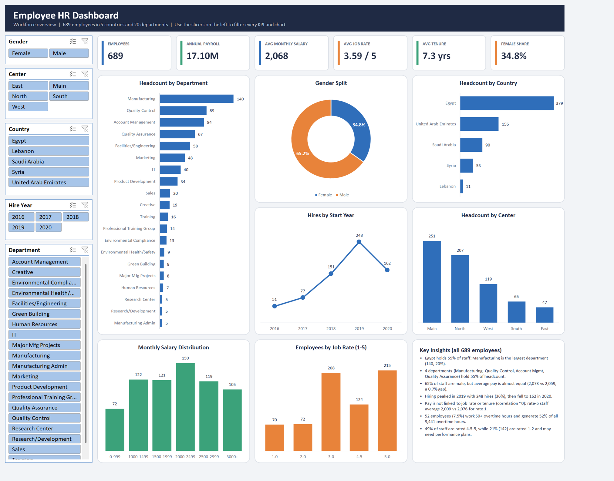

# Excel HR Analytics Dashboard

An interactive HR analytics dashboard built in Microsoft Excel from a 689-employee dataset (Digital Hub data analysis program).



## Excel skills demonstrated

- **Excel Tables & structured references:** helper columns written as table formulas (`[@[Start Date]]`)
- **Formulas:** `GETPIVOTDATA`, `LOOKUP` banding, `IF`/`IFERROR`, `DATEDIF`, `YEAR`
- **PivotTables:** 9 pivot tables on a single shared pivot cache (counts, sums, averages, sorting)
- **PivotCharts:** bar, column, line and doughnut charts with custom formatting
- **Slicers:** 5 slicers connected to every pivot table for fully interactive filtering
- **Dashboard design:** KPI cards linked to cells, a consistent theme palette, a print-ready layout
- **Data cleaning & validation:** quality checks, consistency rules, outlier detection
- **Automation:** the whole workbook can be rebuilt by a VBScript that drives Excel

## Contents

| Path | What it is |
|---|---|
| `Raw Data/Employees.xlsx` | Original dataset (table `EmpTable`, 689 rows x 15 columns) |
| `Output/Employees HR Dashboard.xlsx` | Finished workbook: Dashboard, Data, Analysis, Notes |
| `scripts/build_hr.vbs` | Script that builds the workbook from the raw file through Excel automation |
| `docs/dashboard.png` | Dashboard preview |

## Dashboard

- **KPI cards:** employees, annual payroll, average monthly salary, average job rate, average tenure, female share
- **Charts:** headcount by department, country and center; gender split; hires by start year; monthly salary distribution; employees by job rate
- **Slicers:** Gender, Center, Country, Hire Year, Department, each connected to all 9 pivot tables, so every KPI and chart responds

## Data preparation

- Checked for blanks, extra spaces, inconsistent categories and duplicates; none needed fixing. 14 repeated names are different people.
- Verified Annual Salary = 12 x Monthly Salary on every row.
- Added helper columns: Full Name, Hire Year, Salary Band, Performance, Total Leaves, Overtime Level.
- Removed an empty map chart sheet from the raw file.

## Key insights

- Egypt holds 55% of staff; Manufacturing is the largest department (140 employees, 20%).
- 65% of staff are male, but average pay is almost equal (2,073 vs 2,059).
- Hiring peaked in 2019 (248 hires), then fell to 162 in 2020.
- Pay shows no link to job rate or tenure (correlation about 0).
- 52 employees (7.5%) account for 52% of all overtime hours.

## Rebuild

```
cscript //nologo scripts\build_hr.vbs "%TEMP%\dashboard_preview.pdf"
```
Requires Microsoft Excel on Windows. The script reads `Raw Data\Employees.xlsx` and writes `Output\Employees HR Dashboard.xlsx` (paths are set at the top of the script).
